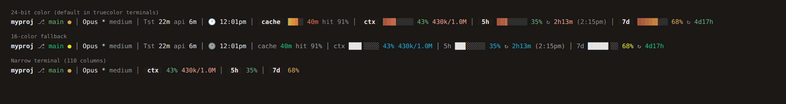

# status-bar-claude

A shell script that renders a real-time Claude Code status line in your terminal.

> Fork of [VCoder4646/status-bar-claude](https://github.com/VCoder4646/status-bar-claude),
> adding session/API timing, context token counts, a live clock, rate-limit
> countdowns, prompt-cache warmth and hit rate, 24-bit colors, 1-second refresh,
> a `curl | bash` installer, and a fixture test suite.



### Status bar elements

```
myproj ⎇ main ● ↑2 │ Opus * medium │ Tst 2m api 1m │ 🕐 5:51pm │ cache 40m hit 91% │ ctx ▉░░░ 4% 40k/1.0M │ 5h ▉▉▊░ 35% ↻ 2h18m (8:10pm) │ 7d ▉░░░ 14% ↻ 6d8h
```

| Segment | Meaning | Source |
|---|---|---|
| `myproj ⎇ main ● ↑2` | Folder, git branch, `●` uncommitted changes, `↑2`/`↓1` commits ahead/behind upstream | `git` (the branch is not in Claude's data) |
| `Opus * medium` | Model, `*` when thinking is on, reasoning effort | Claude |
| `Tst 2m api 1m` | Session time and time spent waiting for the API | Claude |
| `🕐 5:51pm` | Wall-clock time | The system clock |
| `cache 40m hit 91%` | Time left until the prompt cache goes cold (`cache cold` after that) and its hit rate | Claude (`prompt_cache`) |
| `ctx ▉░░░ 4% 40k/1.0M` | Context window use, tokens used / window size | Claude |
| `5h ▉▉▊░ 35% ↻ 2h18m (8:10pm)` | 5-hour limit use, countdown to reset, reset time of day | Claude |
| `7d ▉░░░ 14% ↻ 6d8h` | 7-day limit use and countdown to reset | Claude |

The cache segment appears after the first reply and needs Claude Code 2.1.251
or newer. The `5h` and `7d` segments appear only when Claude Code supplies
rate-limit data (Claude.ai Pro/Max).

### Colors

The default look is a 24-bit "Claude" orange palette: bars with a color gradient
that turns amber at 60% and red at 85%, a solid dark track, dark label chips
(` ctx `, ` 5h `), and a cache bar that goes from orange (fresh) to blue (nearly
cold). Percentages are green below 60%, amber from 60%, and red from 85%.

The script uses 24-bit color when `COLORTERM` is `truecolor` or `24bit`. In any
other terminal it uses the 16 ANSI colors: white bars, and percentages that go
cyan, yellow, red and bold red at 50%, 75% and 90%.

| Variable | Effect |
|---|---|
| `CLAUDE_STATUSLINE_COLOR=16` | Force the 16-color mode |
| `CLAUDE_STATUSLINE_COLOR=truecolor` | Force the 24-bit mode |
| `CLAUDE_STATUSLINE_PAD` | Columns to keep free at the end of the line (default `4`) |

To set a variable for Claude Code, put it in front of the command in
`~/.claude/settings.json`:

```json
"command": "CLAUDE_STATUSLINE_COLOR=16 bash ~/.claude/statusline-command.sh"
```

The installer rewrites this command each time it runs, so set the variable again
after you reinstall.

### Adaptive width

The width comes from the `COLUMNS` variable that Claude Code sets. The line is
rendered at 11 detail levels, from the full line to the folder name alone, and
the first level that fits is used. The least important parts go first: the reset
time of day, the hit rate, the cache segment and 7-day countdown, then the bars,
countdowns, clock and timings, then `7d`, the branch, `5h`, and last the model
name.

### Shared cache

Only the account-wide `5h` and `7d` readings are cached, under
`${XDG_CACHE_HOME:-~/.cache}/claude-statusline/limits`. Claude sends them only
after the first reply, so a new window can show them at once. Every other value
is per window and arrives on every run, so it is never cached and never shows in
another window. The file is validated when read, and a reading whose reset time
has passed is dropped.

### Speed

A run starts 3 processes (`bash`, `jq`, `git`). Everything else uses Bash
builtins, because each extra process costs several milliseconds and the script
runs every second.

## Requirements

- `bash` 4.2 or newer (older versions work, but start more processes)
- `jq`
- `git`
- Claude Code 2.1.251 or newer for the cache segment
- Node 14+ (only for the `npx` install route)

## Installation

### npx (no clone, no install)

```bash
npx status-bar-claude
```

Fetches the package, installs the status line into `~/.claude/`, and exits.
Requires Node 14+ alongside the usual `bash`, `jq`, and `git`. On Windows, run
it inside WSL or Git Bash — the status line itself is a bash script.

### curl one-liner

```bash
curl -fsSL https://raw.githubusercontent.com/Tarakesh-sampath/status-bar-claude/main/install.sh | bash
```

The installer downloads `statusline-command.sh` straight from the repo when it
is run outside a checkout, verifies it is non-empty and passes `bash -n`, then
installs it. Override the source with `STATUSLINE_REPO`, `STATUSLINE_BRANCH`,
or `STATUSLINE_URL`:

```bash
curl -fsSL https://raw.githubusercontent.com/Tarakesh-sampath/status-bar-claude/main/install.sh \
  | STATUSLINE_BRANCH=dev bash
```

### Permissions

The install itself needs **no root** — it only writes `~/.claude/`. Root comes
up in one case: a missing `bash`, `jq`, or `git`, which the installer offers to
install through your package manager and therefore runs under `sudo`.

Because `curl … | bash` hands the script to bash on stdin, `sudo` cannot read a
password there; it falls back to `/dev/tty`. The installer checks for this up
front and, when it cannot escalate (no `sudo`, no tty, no package manager), it
stops with the exact command to run instead of hanging on an invisible prompt.

To keep it entirely out of `sudo`, install the three dependencies first — or
set `STATUSLINE_SKIP_DEPS=1` to skip the check:

```bash
curl -fsSL https://raw.githubusercontent.com/Tarakesh-sampath/status-bar-claude/main/install.sh \
  | STATUSLINE_SKIP_DEPS=1 bash
```

Without `jq`, the installer still writes `~/.claude/settings.json` when there is
nothing to preserve; if that file already has content it refuses to clobber it
and prints the block to paste in by hand.

### From a clone

```bash
git clone https://github.com/Tarakesh-sampath/status-bar-claude.git
cd status-bar-claude
./install.sh
```

This copies `statusline-command.sh` to `~/.claude/` and patches
`~/.claude/settings.json` with the required `statusLine` config. Restart Claude
Code afterward.

### Manual installation

#### 1. Copy the script to your Claude config directory

```bash
cp statusline-command.sh ~/.claude/statusline-command.sh
chmod +x ~/.claude/statusline-command.sh
```

#### 2. Configure Claude Code

In `~/.claude/settings.json`, add:

```json
{
  "statusLine": {
    "type": "command",
    "command": "bash ~/.claude/statusline-command.sh",
    "refreshInterval": 1
  }
}
```

The script reads JSON from stdin (provided by Claude Code) and prints a colored
status string to stdout. You can exercise it by hand:

```bash
echo '{"model":{"display_name":"Opus 5"},"workspace":{"current_dir":"'"$PWD"'"},
"cost":{"total_duration_ms":123456,"total_api_duration_ms":45678}}' \
  | bash statusline-command.sh
```

## Development

```bash
npm test    # syntax checks, CLI version, and tests/run.sh
```

`tests/run.sh` pipes fixture JSON into the script at several widths. It checks
that no line is wider than the terminal, that the segments show the right
values, that bad or missing input does not crash it, and that the cache never
leaks per-window data. It runs in both color modes.

## License

MIT — see [LICENSE](LICENSE).
